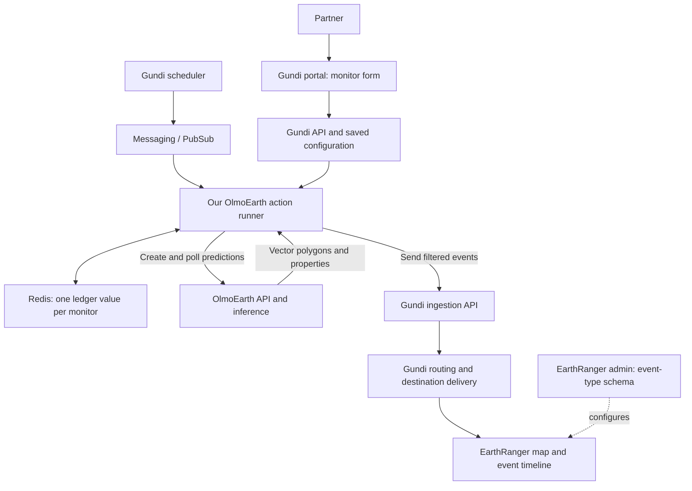
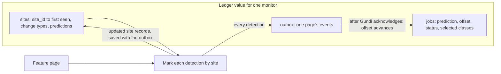
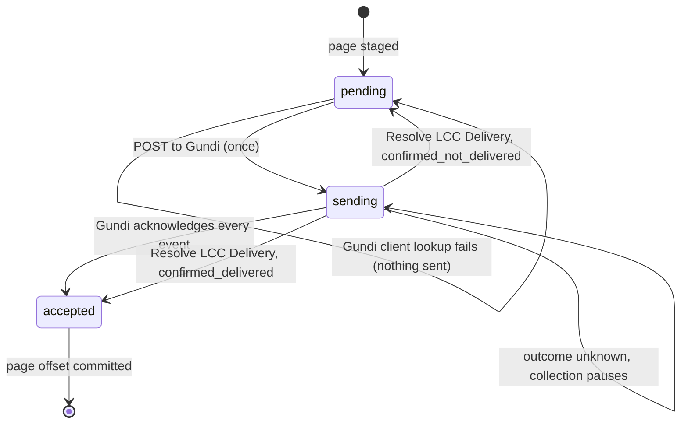

# OlmoEarth, Gundi and EarthRanger — Current Workflow

Updated 2026-10-26. Describes the connector prototype in [PR #2](https://github.com/PADAS/gundi-integration-olmoearth/pull/2), not a verified live deployment.

## Which application am I looking at?

| Application | What it does | What we configure there |
| --- | --- | --- |
| OlmoEarth Studio/API | Owns projects, areas, models, predictions and vector results | Model/vectorization configuration, project access, reusable areas |
| Gundi portal/API | Configures integration instances, actions and delivery routes | OlmoEarth URL/token, project/model/AOI, classes, cadence, destination |
| Our Gundi action runner | Executes the monitor workflow | Python code and runner deployment settings |
| EarthRanger map/event UI | Shows events delivered to the destination | Inspect polygons, dates and event details |
| EarthRanger admin / event-type form builder | Defines the destination event types and fields | Event type identifier, fields and geometry/presentation settings to verify |
| Local runner `/docs` | API explorer for calling runner endpoints | Development inspection; it is not the Gundi partner form |

The supplied [admin link](https://olmoearth.dev.pamdas.org/admin/login/?next=%2Fadmin%2Fform-builder%2Fevent-types) identifies itself as **EarthRanger Administration (advanced view)**. Its `next` parameter points at the event-type form builder. The hostname includes OlmoEarth because it is the named EarthRanger development site; it is not the OlmoEarth prediction API or the Gundi portal. Only the login page was inspected. Existing event types, account permissions, routing and successful polygon rendering remain unverified.

There are two different forms: Gundi's integration form describes **what to monitor**; EarthRanger's event-type form describes **how the resulting event is structured/displayed**. The connector's `event_type` must agree with the destination mapping. Do not assume old notes about automatic event-type creation or point-versus-polygon behavior are verified for this site.

## Components and data flow

These are logical responsibilities, not a verified deployment inventory. Gundi invokes the runner; merely starting the runner does not start its schedule. Opening EarthRanger displays delivered events and does not initiate inference.

## One monitoring cycle

1. Save one Gundi integration for one area/model. Configure the OlmoEarth base URL and token, project, optional organization ownership check, model, area geometry, selected `post_change` labels and cadence.
2. Gundi triggers Submit LCC Predictions every four hours when enabled. The runner checks whether the selected weekly/monthly/quarterly/annual slot is due. Scheduled submission defaults off.
3. Search for the slot's unique prediction name; adopt a single match, otherwise call `POST /api/v1/predictions` once. Record the job (name, prediction ID, reference time, selected classes) only once a prediction ID is in hand, so a lost response is recovered by name on the next run and any failure leaves the slot due. Use a model already configured for vectorization; there is no request-level vectorization flag.
4. Collect LCC Events polls `GET /api/v1/predictions/{id}`. Once complete, read the nested `result.id`.
5. Search `POST /api/v1/prediction-results/{result_id}/features/search` with AOI and class filters. Read date properties from the returned polygons and apply any fixed `changes_since` cutoff locally.
6. For each page, build an event for every monitored detection, marked by its site (`new_site`, `new_change_type` or `seen_before`), and save the updated site records together with the page's outbox. Post the batch to Gundi once; once every event is acknowledged, advance the page checkpoint.
7. Gundi routes events to EarthRanger. An ingestion receipt does not prove final destination delivery; verify that separately.

The model reference time is the due slot minus an imagery lag (14 days, `IMAGERY_LAG_DAYS`). Its own model configuration controls imagery lookbehind. Cadence is not the model's observation window or date precision.

## Change dates and repeated detections

The polygon comes from `post_change`; the change date is an auxiliary property of that polygon. The pilot requires a verified ISO date property and known aggregation/precision. Raw timestep indices and encoded month counts are rejected instead of guessed into dates.

- `recorded_at`: estimated occurrence date, represented as UTC midnight.
- `first_discovered_at`: when the connector found the detection.
- `changes_since`: optional fixed cutoff; never advances as a polling watermark.

A late-finishing prediction can therefore report an older change. Every detection is sent; none are suppressed. Each event carries a `site_id` (`gh7:` plus the geohash cell, about 150 m, containing the polygon) and a title marking it as a new site, a new change type at a known site, or seen before, because EarthRanger cannot filter on event details today. This lets a site's progression (cleared, then mined, then a road) arrive as separate alerts that share a `site_id`. The grid cell is a stand-in for site or change tracking on OlmoEarth's roadmap: a site that crosses a cell edge is reported as new, and unrelated changes in one cell share an ID. Updating or reversing an already delivered EarthRanger event is not implemented.

## State and delivery

Each monitor's state is one value in the runner's Redis, `integration_state.<integration>.lcc_monitor_v1.no-source`, written through the template's `IntegrationStateManager.set_state`, plus a short-lived `...lcc_monitor_v1.lock` key (the template's `set_if_absent`) while a run holds the lock. Only this connector uses these keys; the Redis server and the other integrations' state are unaffected.

The outbox holds one page at a time and moves through these states:

A page with nothing to send skips straight to the commit. Partial acceptance or a lost acknowledgement requires manual reconciliation. Search is limited to the 10,000-feature window; reaching it marks the job `needs_export` without blocking later runs. A raster-only result, a changed result ID, a malformed detection or a prediction deleted in OlmoEarth fails that job at the page where it happened, and the next scheduled submission proceeds. Redis needs durable storage/backups for live use: losing the ledger means every site is reported as new again.

## Reusable areas — agreed next step, not implemented

The partner should see the selected project's existing areas and choose one, or choose **Create new area**. They name and draw/upload the boundary, save it to the OlmoEarth project, and the newly returned area ID becomes available for future selections.

The desired connector contract is an area ID plus a resolved geometry snapshot for the prediction/filter boundary. The current code accepts geometry directly and snapshots the configuration per job. It does not yet list or create areas. Verify the Studio list/create endpoints, permissions and Gundi reference-field/map/upload support before implementing this flow. Define how a later edit to a saved boundary affects a monitor; do not silently mix boundaries with pending jobs.

## Credentials and configuration

| Value | Where it belongs | Current state |
| --- | --- | --- |
| OlmoEarth environment URL | Gundi integration site/base URL | Placeholder |
| OlmoEarth API token | Authenticate action; Bearer header on OlmoEarth requests | Placeholder |
| Project/model/optional organization/AOI | Collect LCC Events action | Placeholder examples |
| Gundi OAuth and API settings | Runner deployment/local environment | Example defaults and secret placeholder; confirm with Gundi team |
| EarthRanger destination credentials and mapping | Gundi route/destination | Not verified |
| EarthRanger admin login | EarthRanger website | User has a login; separate from API credentials above |

Do not put real secrets in notes or committed examples. An EarthRanger admin login alone does not supply Gundi OAuth or an OlmoEarth API token.

## Code layout and current implementation status

| File | Responsibility |
| --- | --- |
| `configurations.py` | Form fields and validation |
| `handlers.py` | Gundi action wiring |
| `client.py` | OlmoEarth HTTP calls and API schemas |
| `monitor.py` | Submission, polling, pagination and recovery |
| `monitor_state.py` | Ledger models (jobs, site records, outbox) and monitor identity |
| `delivery.py` | One-shot Gundi posting and acknowledgement check |
| `change_events.py` | Dates, site IDs and event payloads |
| Shared `routers/actions.py` | Runner HTTP action endpoints |
| Shared services | Gundi authentication/configuration, Redis and ingestion |

The shared runner code (`app/services`, from the upstream action-runner template) is unchanged; the connector only calls its existing helpers.

The implementation is on `olmoearth-integration` in PR #2, based on the fork's `main` (the fork has no `develop`). The latest revision passes 429 local tests, including an end-to-end monitor test against a disposable Redis (`OLMOEARTH_TEST_REDIS_URL`); without it that test skips. This proves mocked contracts/workflows, not a live end-to-end deployment. No live prediction or event has been sent in this work. Studio PR #3226 and a new cross-result/events API are not prerequisites.

## Pilot completion criteria

Use one small mining AOI. Confirm credentials and date semantics; register/deploy the runner with Redis; configure the Gundi route and EarthRanger event type; submit a real prediction; inspect its polygons; collect; verify geometry, date and fields in EarthRanger. Run a second reference date to inspect how repeats are marked and how many arrive. Only then enable recurring submission and validate cost, recovery and multiple cycles. Studio viewer links/thumbnails, destination updates, large-result export and real site/change tracking from OlmoEarth remain follow-up work.
